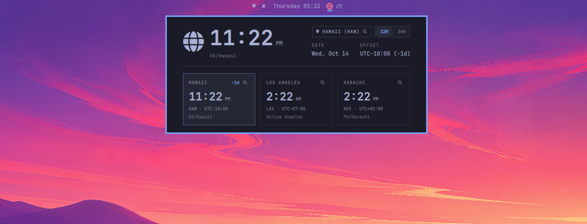
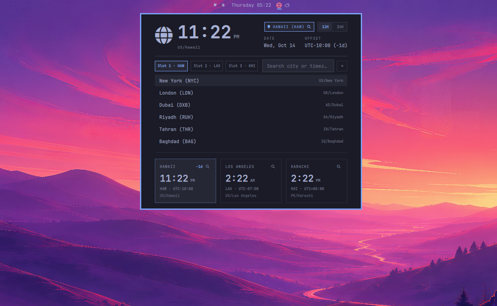

# Clocker World Clock (`szaidi.clocker`)

A native [Omarchy](https://omarchy.org/) status bar widget and world clock popup inspired by the built-in Omarchy Weather panel. Displays a centered vector globe icon in the bar and opens a compact popup featuring your 3 favorite cities, an instant searchable city/timezone picker (`Country/City` abbreviations), and a `12H | 24H` toggle.

<p align="center">
  
</p>

<p align="center">
  
</p>

## Installation

Install and enable directly via the Omarchy plugin CLI:

```bash
omarchy plugin add https://github.com/szaidi-code/clocker.git --enable
```

To place it right beside your center clock:

```bash
omarchy bar move szaidi.clocker --section center
```

## Removal

Disable and remove the plugin via the Omarchy plugin CLI:

```bash
omarchy plugin remove szaidi.clocker
```

To also remove saved user preferences (`~/.config/clocker/`):

```bash
rm -rf ~/.config/clocker
```

## Dependencies

- **Omarchy 4 (Quattro)** / Quickshell (`omarchy-shell`)
- **`bash`**, **GNU `coreutils` (`date`)**, **`gawk` (`awk`)**, **`jq`** (pre-installed on Omarchy)
- **`tzdata`** (`/usr/share/zoneinfo/` for offline IANA timezone and country lookup)
- **`wl-clipboard` (`wl-copy`)** *(optional, for click-to-copy time on city cards)*

No network calls, background daemons, or elevated privileges (`sudo`/`pkexec`) are used.

## Features

- **Centered Vector Globe Bar Icon**: Takes a single status icon slot in your top bar, geometrically centered above the active panel underline indicator.
- **3 Favorite City Cards**:
  - Live time, relative day badge (`+1d` / `-1d`), 3-letter city code, UTC offset (`UTC-04:00`), and compact `CC/City` subtitle (e.g., `PK/Karachi`, `US/Los Angeles`, `IQ/Baghdad`).
  - Click any city card to focus it in the large Hero clock and copy its formatted time to your Wayland clipboard (`wl-copy`).
- **Searchable City & Timezone Picker**:
  - Click the top-right city pill (` CITY `) or the `` icon on any of the 3 city cards to open the full-width search drawer.
  - Switch between `Slot 1`, `Slot 2`, and `Slot 3` and search offline by city name, 3-letter code, country code, full country name, or any system IANA timezone.
- **`12H | 24H` Segmented Toggle**:
  - Switch instantly between 12-hour (`AM`/`PM`) and 24-hour display; persists across restarts in `~/.config/clocker/format.conf`.

## IPC & CLI Commands

Control the popup from scripts or keybindings:

```bash
# Toggle the world clock popup
omarchy-shell ipc call szaidi.clocker toggle

# Open directly in city search mode
omarchy-shell ipc call szaidi.clocker edit

# Open / close / refresh explicitly
omarchy-shell ipc call szaidi.clocker open
omarchy-shell ipc call szaidi.clocker close
omarchy-shell ipc call szaidi.clocker refresh
```

## Configuration Storage

User preferences are stored outside the plugin directory in `~/.config/clocker/` so plugin updates never overwrite your favorite cities:
- `~/.config/clocker/zones.conf` — Your 3 favorite `LABEL=IANA/Zone` entries.
- `~/.config/clocker/format.conf` — Saved `12h` or `24h` preference.

## License

MIT © [Sajjad Zaidi](https://github.com/szaidi-code) — see [LICENSE](LICENSE).
